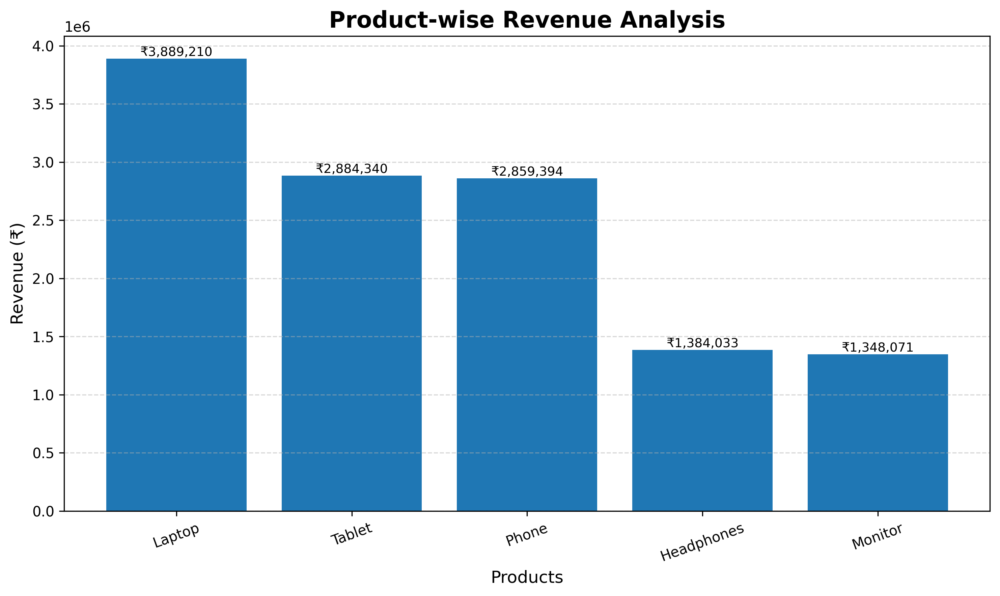
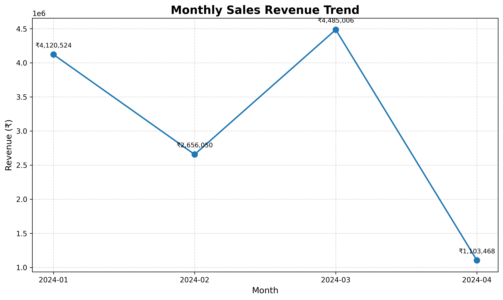
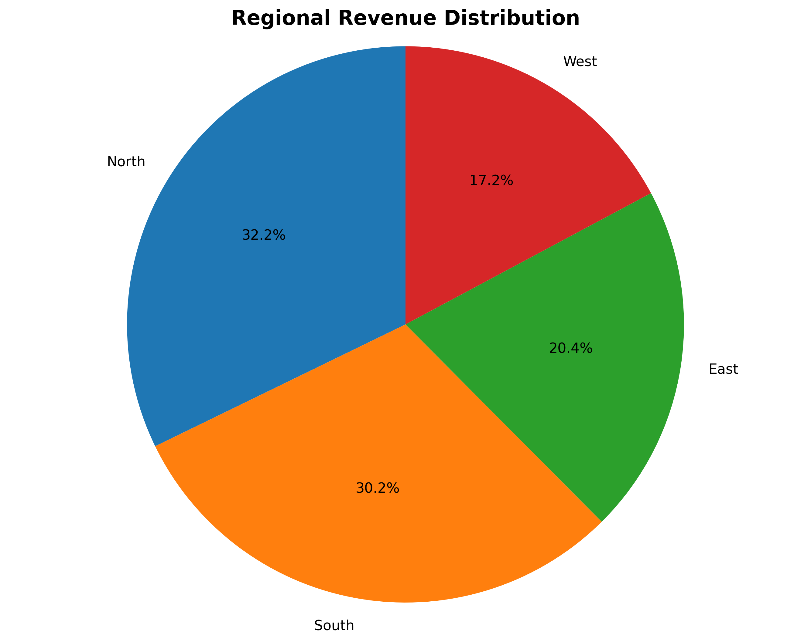

# Week 4 – E-commerce Sales Analysis and Visualization

## Project Overview

This project focuses on analyzing e-commerce sales data using Python, Pandas, NumPy, and Matplotlib.

The objective is to build a complete data analysis pipeline that loads, validates, cleans, analyzes, and visualizes sales data to identify meaningful business insights.

## Objectives

* Load and explore an e-commerce sales dataset.
* Identify and handle missing values and duplicate records.
* Perform product-wise, region-wise, and monthly sales analysis.
* Create professional visualizations using Matplotlib.
* Generate a structured analytical report with business insights.

## Technologies Used

* Python 3.10
* Pandas
* NumPy
* Matplotlib

## Project Structure

```text
Week-4/
│
├── data/
│   ├── sales_data.csv
│   └── cleaned_sales_data.csv
│
├── visualizations/
│   ├── product_sales_bar.png
│   ├── monthly_sales_line.png
│   └── regional_sales_pie.png
│
├── report/
│   └── analysis_report.md
│
├── main.py
├── requirements.txt
└── README.md
```

## Dataset Description

The dataset contains 100 e-commerce sales records with the following attributes:

* Date
* Product
* Quantity
* Price
* Customer_ID
* Region
* Total_Sales

## Data Analysis Pipeline

1. Data Loading – Import the dataset using Pandas.
2. Data Validation – Verify the required columns.
3. Data Exploration – Examine records, data types, statistics, missing values, and duplicates.
4. Data Cleaning – Handle invalid values, duplicates, and missing data.
5. Sales Analysis – Calculate revenue, units sold, and sales distribution.
6. Data Visualization – Generate three visualizations using Matplotlib.
7. Report Generation – Create a Markdown report containing findings and charts.

## Key Results

| Metric                    |      Result |
| ------------------------- | ----------: |
| Total Revenue             | ₹12,365,048 |
| Total Units Sold          |         478 |
| Average Transaction Value | ₹123,650.48 |
| Unique Customers          |         100 |
| Best-selling Product      |      Laptop |
| Highest Revenue Region    |       North |
| Highest Revenue Month     |  March 2024 |

## Visualizations

### 1. Product-wise Revenue Analysis



### 2. Monthly Sales Revenue Trend



### 3. Regional Revenue Distribution



## Business Insights

* Laptops generated the highest revenue and recorded the highest sales quantity.
* The North region contributed the highest revenue.
* March 2024 recorded the highest monthly revenue.
* The dataset contains 100 unique customers.
* The dataset had no missing values or duplicate records.

## Installation and Execution

Clone the repository:

```bash
git clone https://github.com/Sankarshancn-lab/developers-arena-python-tasks.git
```

Navigate to the Week 4 directory:

```bash
cd developers-arena-python-tasks/Week-4
```

Install dependencies:

```bash
pip install -r requirements.txt
```

Run the project:

```bash
python main.py
```

## Output

The project automatically generates:

* Cleaned sales dataset.
* Product-wise revenue bar chart.
* Monthly sales line chart.
* Regional revenue pie chart.
* Detailed Markdown analysis report.

## Conclusion

This project demonstrates a complete data analysis workflow using Python. It combines data preprocessing, exploratory analysis, business insights, data visualization, and automated report generation.

The results provide an overview of product performance, regional revenue distribution, and monthly sales trends.
