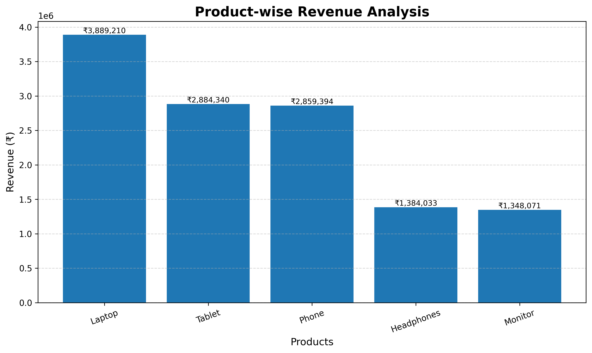
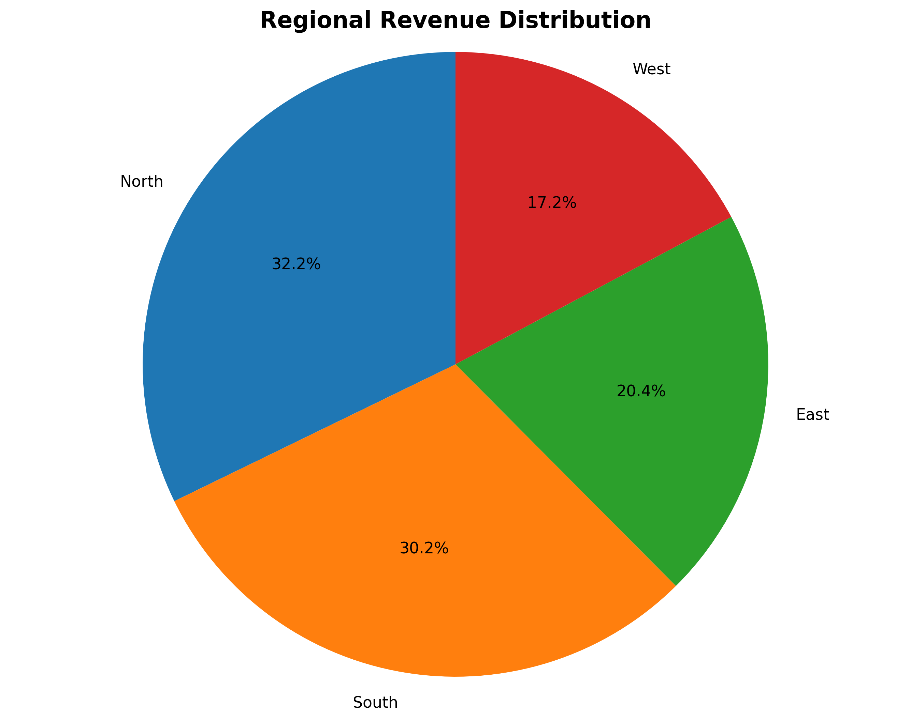
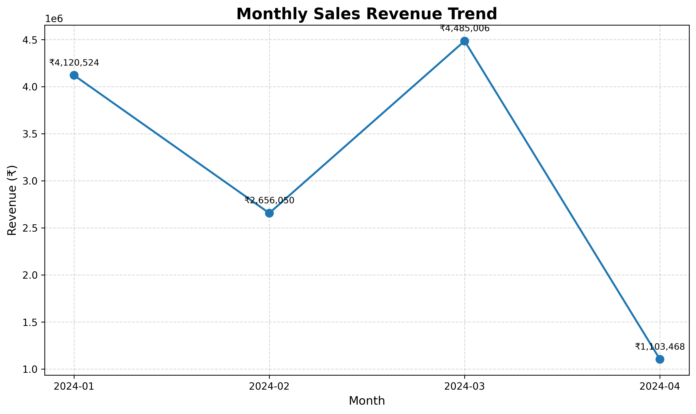

# E-commerce Sales Analysis and Visualization

**Developers Arena Python Internship – Week 4**

---

## 1. Project Overview

This project analyses e-commerce sales transaction data using Python,
Pandas, NumPy and Matplotlib.

The objective is to identify product performance, regional revenue
distribution, monthly sales trends and important business insights.

The project implements a complete data analysis workflow, including
data loading, exploration, cleaning, validation, statistical analysis,
visualization and automated report generation.

## 2. Dataset Description

| Attribute | Details |
|---|---|
| Dataset | E-commerce Sales Data |
| Total Records | 100 |
| Total Columns | 7 |
| Starting Date | 01 January 2024 |
| Ending Date | 09 April 2024 |
| Unique Customers | 100 |

### Dataset Columns

| Column | Description |
|---|---|
| Date | Transaction date |
| Product | Product purchased |
| Quantity | Number of units purchased |
| Price | Unit price |
| Customer_ID | Customer identification |
| Region | Sales region |
| Total_Sales | Total transaction value |

## 3. Data Cleaning and Validation

The following preprocessing operations were implemented:

- Checked the dataset for missing values.
- Identified and removed exact duplicate records.
- Converted the Date column into datetime format.
- Converted numeric columns into appropriate numeric types.
- Implemented mode imputation for missing categorical values.
- Implemented median imputation for missing numerical values.
- Removed invalid dates and non-positive quantities.
- Recalculated transaction revenue using Quantity × Price.
- Validated numeric values before analysis.

### Data Quality Summary

| Validation | Result |
|---|---:|
| Records after cleaning | 100 |
| Missing values remaining | 0 |
| Duplicate records remaining | 0 |

The supplied dataset contained no missing values or duplicate
records, so no imputation or duplicate removal was necessary.

## 4. Key Business Metrics

| Metric | Result |
|---|---:|
| Total Revenue | ₹12,365,048.00 |
| Total Units Sold | 478 |
| Average Transaction Value | ₹123,650.48 |
| Unique Customers | 100 |
| Best-Selling Product | Laptop |
| Highest Revenue Product | Laptop |
| Highest Revenue Region | North |
| Highest Revenue Month | 2024-03 |

## 5. Product Performance Analysis

The following table compares product-wise sales quantity and revenue.

| Product | Units Sold | Revenue |
|---|---:|---:|
| Laptop | 136 | ₹3,889,210.00 |
| Tablet | 127 | ₹2,884,340.00 |
| Phone | 101 | ₹2,859,394.00 |
| Headphones | 48 | ₹1,384,033.00 |
| Monitor | 66 | ₹1,348,071.00 |

### Product Revenue Visualization

### Product Insights

- Laptop recorded the highest sales quantity.
- Laptop generated the highest revenue.
- The highest-revenue product contributed approximately
  31.45% of total revenue.
- Product performance can help businesses prioritize inventory
  and marketing activities.

## 6. Regional Sales Analysis

The following table presents revenue generated across different regions.

| Region | Revenue | Revenue Share |
|---|---:|---:|
| North | ₹3,983,635.00 | 32.22% |
| South | ₹3,737,852.00 | 30.23% |
| East | ₹2,519,639.00 | 20.38% |
| West | ₹2,123,922.00 | 17.18% |

### Regional Revenue Visualization

### Regional Insights

- North generated the highest regional revenue.
- This region contributed approximately 32.22%
  of total revenue.
- Regional performance differences can help businesses identify
  opportunities for targeted marketing and sales improvement.

## 7. Monthly Sales Trend Analysis

The monthly revenue distribution is shown below.

| Month | Revenue |
|---|---:|
| 2024-01 | ₹4,120,524.00 |
| 2024-02 | ₹2,656,050.00 |
| 2024-03 | ₹4,485,006.00 |
| 2024-04 | ₹1,103,468.00 |

### Monthly Sales Visualization

### Monthly Insights

- 2024-03 recorded the highest revenue.
- Monthly comparisons help identify changes in sales performance.
- April contains data only up to 9 April 2024, so it represents
  a partial month and should not be compared directly with
  complete months.

## 8. Business Recommendations

Based on the analysis, the following recommendations can be considered:

1. **Product Strategy:** Prioritize inventory planning for
   Laptop, which recorded the highest sales quantity.

2. **Regional Strategy:** Investigate the successful sales patterns
   in North and identify opportunities to improve
   performance in other regions.

3. **Sales Monitoring:** Track monthly revenue to identify
   performance changes and potential seasonal patterns.

4. **Business Intelligence:** Use product-wise and regional
   performance metrics to support data-driven business decisions.

## 9. Technologies Used

| Technology | Application |
|---|---|
| Python | Main programming language |
| Pandas | Data processing and analysis |
| NumPy | Numerical operations |
| Matplotlib | Data visualization |
| CSV | Dataset storage |
| Git and GitHub | Version control |

## 10. Project Workflow

1. Load the sales dataset.
2. Explore the dataset structure and statistics.
3. Validate required columns.
4. Clean and preprocess the data.
5. Calculate business performance metrics.
6. Generate bar, line and pie charts.
7. Export the cleaned dataset.
8. Generate this automated analysis report.

## 11. Conclusion

The project successfully analysed 100 e-commerce
transactions and identified important patterns in product,
regional and monthly sales performance.

The analysis generated total revenue of ₹12,365,048.00
across 478 units sold.

Laptop was the best-selling product, while
North generated the highest regional revenue.

The project demonstrates how Python-based data analysis and
visualization can transform raw sales data into meaningful
business insights.

---

**Report generated automatically using Python, Pandas and Matplotlib.**
